  <a href="https://zaidhsaine.com/">Portfolio</a> &nbsp; · &nbsp;
  <a href="https://github.com/hsainezaid0?tab=repositories">My repositories</a>

I'm **Zaid**, a Computer Engineering student at **EMSI**, currently on an academic exchange at **EPITECH Paris**. I'm learning through projects, with a growing interest in **cybersecurity** and **artificial intelligence**.

  
  

  
  

  
About these visuals

The cards are SVG images rendered directly by GitHub. The arcade and chessboard are decorative animations. They are not playable games.

The city uses real GitHub contribution dates and counts. The language card uses language bytes from public repositories, excluding forks and this profile repository. Percentages describe code distribution, not proficiency. Until the first live sync, the cards use a public snapshot from 27 October 2026; language percentages are explicitly marked as pending.

After setup, a GitHub Actions workflow refreshes the data daily. See [SETUP.md](SETUP.md) for installation and customization.

